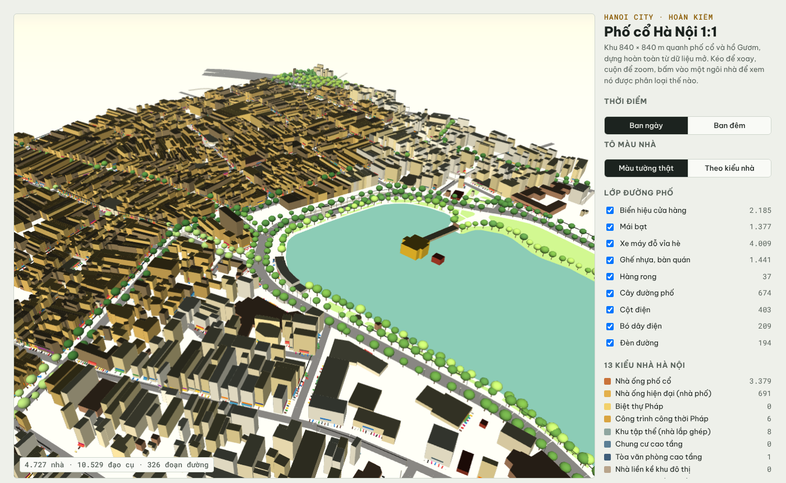
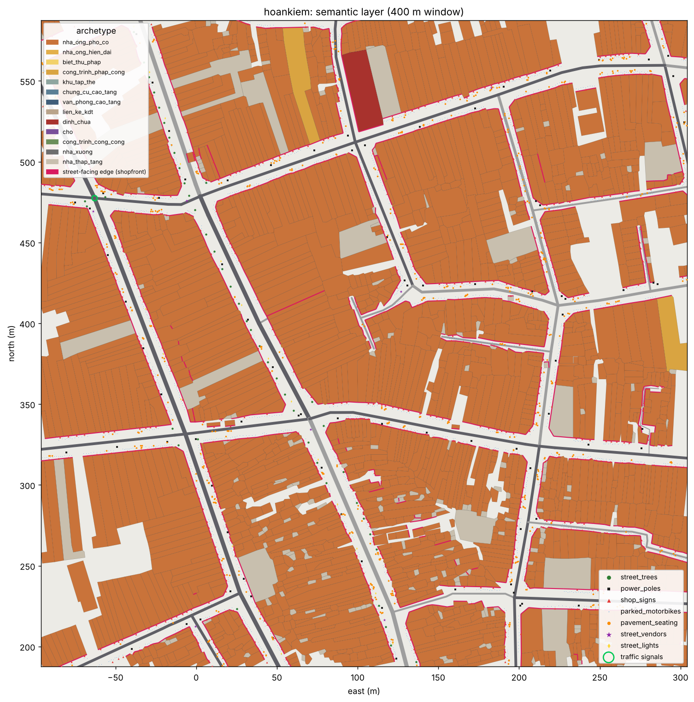

# Hanoi City

Một thế giới mở kiểu GTA5 đặt ở Hà Nội, không bạo lực: nhìn là nhận ra Hà Nội, dựng từ dữ liệu
thật và cập nhật theo dữ liệu thật. Repo này chứa **mọi thứ trước khi cắm vào Unreal Engine 5**:
pipeline dựng thành phố, dữ liệu thiết kế game, và harness để nạp tất cả vào UE 5.8.

| Thư mục | Nội dung |
| --- | --- |
| `fetch.py`, `build.py` | Lấy dữ liệu mở (Overture Maps, Copernicus DEM) và dựng khối 3D theo ô |
| `pipeline/` | Lớp ngữ nghĩa: 13 kiểu nhà Hà Nội, mặt tiền hướng phố, đồ thị giao thông, đạo cụ đường phố cho PCG; `run_districts.py` dựng 12 quận nội thành chung một gốc tọa độ |
| `live/` | Thời tiết thật (hoặc khí hậu nướng sẵn), cập nhật bản đồ khi Overture ra bản mới |
| `game/schemas`, `game/content` | Thiết kế game dạng dữ liệu: quận, công trình, nhân vật, xe, việc làm, nhiệm vụ, hội thoại, sự kiện, luật giao thông |
| `ue5/` | Project UE 5.8, plugin `HanoiCity` (C++), script import Python |
| `tools/` | Kiểm tra nội dung, giả lập chơi thử cốt truyện (`playtest.py`), sinh USTRUCT từ schema, xuất bản xem trước web |
| `docs/` | Nghiên cứu, kiến trúc, giấy phép dữ liệu, hướng dẫn tích hợp UE5, lộ trình, tài liệu thiết kế game |

Đọc trước: [docs/02-kien-truc.md](docs/02-kien-truc.md), rồi [docs/06-lo-trinh.md](docs/06-lo-trinh.md). Ngày cắm UE5: [docs/05-tich-hop-ue5.md](docs/05-tich-hop-ue5.md); kết quả QC cuối: [docs/07-qc-checklist.md](docs/07-qc-checklist.md); chơi thử và thẩm định cốt truyện chương 1: [docs/11-tham-dinh-choi-thu.md](docs/11-tham-dinh-choi-thu.md); mở màn và hệ quả lựa chọn (cold open, thoại có điều kiện, chương 2): [docs/gdd/11-mo-man-va-he-qua.md](docs/gdd/11-mo-man-va-he-qua.md).

## Chạy nhanh

```bash
python -m venv venv && ./venv/bin/pip install -r requirements.txt -r requirements-dev.txt

# Cả pipeline cho phố cổ + hồ Gươm (~5 phút, phần lớn là tải dữ liệu)
./venv/bin/python -m pipeline.run --name hoankiem --bbox 105.840,21.020,105.860,21.042

./venv/bin/python tools/validate.py      # nội dung game khớp schema, tham chiếu đúng
./venv/bin/python -m pytest -q           # kiểm thử
./venv/bin/python -m live.weather        # thời tiết Hà Nội ngay lúc này
```

```bash
# 12 quận nội thành từ một lần tải (xem docs/12-cac-quan.md): ~5 phút tải, ~2-4 phút dựng mỗi quận
./venv/bin/python fetch.py --name noi_thanh --bbox 105.72,20.93,105.95,21.12
./venv/bin/python -m pipeline.fetch_context --name noi_thanh
./venv/bin/python -m pipeline.run_districts            # pipeline/districts.json: khung từng quận, gốc chung ở hồ Gươm
./venv/bin/python -m pipeline.verify_landmarks --data noi_thanh --fix   # khớp tọa độ địa danh, không cần mạng
./venv/bin/python tools/playtest.py                    # chơi thử cốt truyện bằng dữ liệu (docs/gdd/06, 07)
```

Kết quả trên khung Hoàn Kiếm (Overture 2026-09-23.0): 17.688 tòa nhà được phân loại theo 13 kiểu
nhà Hà Nội, 2.285 nút / 111 km đường xe chạy được (98,9% liên thông, 134 nút có đèn tín hiệu),
khoảng 63.000 đạo cụ đường phố (biển hiệu theo cửa hàng thật, xe máy đỗ, ghế nhựa, hàng rong, cây,
cột điện và bó dây). Xem trước 3D: `tools/export_web_demo.py` + `viewer/city.html`.





Nếu máy không tải được extension DuckDB từ extensions.duckdb.org, cài bản đóng gói trên PyPI:
`pip install duckdb==1.5.5 duckdb-extension-httpfs duckdb-extension-spatial` (vẫn kiểm tra chữ ký).

---

## Pipeline khối thành phố (fetch.py, build.py)

Pipeline dựng khung thành phố tỷ lệ 1:1 từ dữ liệu mở (không dùng dữ liệu Google Earth).

```bash
python -m venv venv && ./venv/bin/pip install -r requirements.txt

# Một khu vực nhỏ theo bbox (tây,nam,đông,bắc)
./venv/bin/python fetch.py --name caugiay --bbox 105.785,21.028,105.805,21.040
./venv/bin/python build.py --name caugiay --tile 500

# Cả tỉnh/thành theo mã ISO 3166-2 (ranh giới sau sáp nhập 2025)
./venv/bin/python fetch.py --name hanoi --region VN-HN
./venv/bin/python build.py --name hanoi --tile 1000
./venv/bin/python fetch.py --name saigon --region VN-SG
```

`fetch.py` đọc trực tiếp GeoParquet của Overture Maps trên S3 công khai (truy cập ẩn danh) và
Copernicus DEM GLO-30. `build.py` chia việc theo ô: tiến trình chính chỉ tính khóa ô, mỗi worker
tự đọc ô của mình, nên bộ nhớ không tăng theo kích thước thành phố.

Số đo trên máy 4 nhân, 16 GB RAM (Overture 2026-09-23.0):

| Vùng | Tòa nhà | Đoạn đường | Tải dữ liệu | Dựng | Đầu ra |
| --- | --- | --- | --- | --- | --- |
| Cầu Giấy (bbox 2,1 × 1,3 km) | 8.912 | 1.701 | 2,5 phút | 7 giây | 24 ô 500 m |
| TP Hà Nội (VN-HN) | 2.509.832 | 301.549 | ~4 phút | 17 phút | 3.512 ô 1 km, 53,2 triệu tam giác, 2,2 GB |

## Xem trên trình duyệt

```bash
./venv/bin/python package_viewer.py --name caugiay --overview out/hanoi/preview.png
python -m http.server -d site/caugiay
```

`viewer/walk.html` là bản chơi thử **góc nhìn thứ ba**: đi bộ trên vỉa hè thật của khu vực
(WASD, Shift để chạy, kéo chuột để xoay, thanh giờ đặt mặt trời theo vĩ độ Hà Nội). Mặt tiền,
cửa cuốn, biển hiệu, ban công, điều hòa, téc nước, cây, cột điện và dây, xe máy đỗ, ghế nhựa
đều sinh trong trình duyệt từ "công thức mặt tiền" của từng tòa. Thêm `#lite` vào URL để tắt
bóng đổ trên máy yếu. Lựa chọn công nghệ cho bản Unreal: [docs/research-2026-10.md](docs/research-2026-10.md).

`viewer/index.html` là trình xem three.js: xoay quanh khu vực, bấm vào một tòa để xem chiều cao
và nguồn của nó. Ô được gửi dưới dạng base64 (`.glb.txt`) vì nhiều nơi lưu trữ không phục vụ
`.glb` và chặn `fetch` tới URL `data:`.

## Ảnh đường phố thật (`streetview.py`)

Ảnh 360° mở của [KartaView](https://kartaview.org) và [Mapillary](https://www.mapillary.com)
(cả hai CC BY-SA 4.0, mặt người và biển số đã được nguồn làm mờ) cho diện mạo thật ở mặt đất mà
dữ liệu bản đồ không có.

```bash
./venv/bin/python streetview.py harvest   --name caugiay   # danh sách ảnh KartaView trong khu vực
MAPILLARY_TOKEN='MLY|...' ./venv/bin/python streetview.py mapillary --name caugiay   # ảnh 360° Mapillary + tư thế SfM
./venv/bin/python streetview.py download  --name caugiay   # ảnh cầu 360° đầy đủ của cả hai nguồn
./venv/bin/python streetview.py sequences --name caugiay   # chuỗi chụp KartaView, để suy hướng di chuyển
./venv/bin/python streetview.py pose      --name caugiay   # sửa tư thế GPS điện thoại (KartaView)
./venv/bin/python streetview.py depth     --name caugiay   # độ sâu từ chính ảnh -> phố thật dựng 3D
./venv/bin/python streetview.py facades   --name caugiay   # chiếu ảnh lên mặt tiền (thử nghiệm)
./venv/bin/python streetview.py check     --name caugiay   # vẽ tường đè lên panorama + ảnh ghép mặt tiền
./venv/bin/python streetview.py viewer    --name caugiay --site site/caugiay [--facades]
./venv/bin/python streetview.py tour      --name caugiay --site site/caugiay --montage --ids <id>,<id>,...
```

`pose` kéo mỗi ảnh KartaView về làn đường bên phải gần nhất, vì người chụp luôn đi trên đường.
Hướng lấy theo thứ tự tin cậy: hướng di chuyển trong chuỗi, la bàn ghi kèm, rồi chỗ bầu trời lộ ra
so với mô hình khối nhà. KartaView để trống hướng khi thiết bị không ghi; trống được giữ là trống,
không bị đọc thành hướng Bắc. Mỗi ảnh mang nhãn `quality`; ảnh `uncertain` không dùng để dán
mặt tiền.

`mapillary` tìm ảnh qua vector tile phủ khu vực (Graph API v4 không tìm được theo bbox cho ảnh ở
đây), rồi hỏi Graph API `computed_geometry`, `computed_compass_angle`, `computed_rotation`,
`camera_type`, `sequence`, `captured_at` của từng ảnh. Tư thế đã qua SfM của Mapillary được dùng
thẳng, không qua bước sửa GPS. Khi Graph API không trả lời, tư thế lấy từ tileset
`mly1_computed_public` (cùng SfM, nhưng tọa độ làm tròn tới ~0,55 m). Chỉ giữ ảnh có tư thế SfM,
mỗi 8 m một ảnh, ưu tiên ảnh mới. `download` hỏi `thumb_original_url` ngay trước khi tải vì URL có
hạn dùng. `facades` ưu tiên ảnh có tư thế SfM.

`check` ghi `out/<name>/check/<ảnh>.jpg`: panorama với tường trong 30 m vẽ đè (vàng = chân tường,
đỏ = đỉnh, xanh = góc nhà) và `facades_sheet.jpg` ghép các texture mặt tiền. Tư thế đúng thì
đường vàng nằm đúng chỗ tường chạm vỉa hè và đường xanh trùng góc nhà. `viewer` chỉ chép mặt tiền
ảnh sang trang khi có `--facades`, tức là sau khi `check` đã đạt.

### Không gian ảnh thật

Nguyên tắc: nơi có ảnh thật thì thế giới game phải là chính con phố trong ảnh, không phải khối
hộp đoán ra từ bản đồ. `depth` ước lượng khoảng cách tới từng điểm ảnh của panorama bằng
[Depth Anything V2](https://github.com/DepthAnything/Depth-Anything-V2) (bản Small; bản metric
outdoor cho khoảng cách, bản relative để nhận bầu trời, vì bản metric đặt trời trắng đục chỉ cách
vài mét). Mô hình chạy trên CPU, ~30 giây một ảnh; cài riêng bằng `requirements-depth.txt`.
Thang đo được chỉnh sơ bộ sao cho mặt đường nằm dưới máy ảnh `CAMERA_HEIGHT_M`. Trong trình duyệt,
mặt đường thật của từng ảnh được tìm lại bằng RANSAC: máy ảnh đội trên mũ bảo hiểm thường ngả
13–27°. Cả cảnh được xoay cho mặt đường nằm ngang, máy ảnh cao đúng 1,8 m trên mặt đường đó, rồi
mặt đường được ép phẳng. Kết quả ghi vào `data/<name>/depth/<ảnh>.png`: centimet trong kênh R và G, loại
điểm trong kênh B (bề mặt, trời, hay giá chụp).

Trong `walk.html`, đi tới gần một cột xanh (điểm chụp) thì phố hộp nhường chỗ cho chính panorama
đó dựng thành lưới 3D theo độ sâu: tường, cửa cuốn, dây điện, xe đỗ đúng khoảng cách đo từ ảnh.
Nhân vật đi lại bên trong và va chạm với tường thật trong ảnh, không phải với footprint. Mép vật
thể (mái nhà trên nền trời, xe trên nền đường) được đẩy ra làm nền phía sau thay vì kéo dãn. Ảnh
chỉ đúng tuyệt đối khi nhìn từ chỗ đặt máy, nên camera giữ trong vòng 0,5 m quanh điểm chụp và
quay theo nhân vật, giống camera cố định của các game nền dựng sẵn. Cách điểm chụp hơn ~6 m, phố
hộp hiện dần trở lại; quá 10 m là hết. `#pano=<id>` trên URL đưa người chơi tới điểm chụp đó; `P`
vẫn mở ảnh 360° phẳng tại chỗ.

### Nhân vật và video

Nhân vật là `Male_Adult_09` của Microsoft Rocketbox (MIT): người thật quét dựng, áo phông, quần
jean, với chuyển động đứng / đi / chạy chậm / chạy quay bằng motion capture. Để nhân vật thuộc về
con phố trong ảnh chứ không dán đè lên ảnh:

- **Chân không trượt.** Tốc độ của mỗi kiểu bước được đo từ bàn chân đang chạm đất trong chính
  clip (đi 1,0 m/s, chạy chậm 2,5 m/s, chạy 3,25 m/s); clip được phát nhanh chậm đúng theo tốc độ
  di chuyển thật.
- **Chân chạm đất.** Ảnh được cân bằng theo mặt đường thật (xem trên). Mặt đường ước lượng gồ ghề
  vài centimet, đủ để lấp mất bàn chân, nên mọi điểm trong vòng 35 cm quanh mặt đường được ép
  phẳng; nhân vật đứng đúng trên mặt phẳng đó, có bóng tiếp xúc mềm dưới chân. Ở ngõ dốc, mặt
  phẳng chỉ khớp được trong khoảng 10 m quanh máy ảnh.
- **Đúng hướng.** Nhân vật chạy theo hành lang thông thoáng dài nhất mà ảnh cho thấy (trong ±35°
  quanh hướng phố), quay mặt theo hướng chạy.
- **Cùng ánh sáng với ảnh.** Nhân vật được chiếu bằng chính panorama (image-based lighting, xoay
  cho khớp hướng chụp), và lớp ảnh lẫn nhân vật cùng đi qua một đường màu, không tone mapping
  riêng cho nhân vật. Không đổ bóng nắng: ước lượng mặt trời từ một ảnh không đáng tin, bóng đổ
  sai hướng còn lộ hơn không có bóng, và phần lớn ảnh Hà Nội là trời âm u.

Cách dựng lại nhân vật: [tools/character](tools/character/README.md).

`tour` ghi `tour.json` cho `walk.html#tour`. Với `--montage`, mỗi điểm chụp là một cảnh: camera
đứng đúng chỗ máy ảnh thật nên mọi điểm ảnh của con phố là ảnh gốc, nhân vật lần lượt chạy xa dần
hoặc chạy lại phía ống kính và dừng trước vật cản có trong ảnh. Không có `--montage` thì là một
đường chạy liền theo mạng đường. Quay video:

```bash
python -m http.server 8765 -d site/caugiay &
node tools/video/record.mjs /tmp/frames 30                 # walk.html#record, từng khung một
./venv/bin/python tools/video/compose.py /tmp/frames site/caugiay/tour.json out.mp4 30
```

`#record` cho trang chạy theo nhịp khung hình (không theo đồng hồ) và đợi ảnh tải xong, nên video
mượt kể cả khi máy dựng chậm. Khi quay, nên dựng trang với panorama 8192 px (`viewer --width 8192`,
giới hạn texture của WebGL) cho ảnh nét ngang nhân vật. `compose.py` thêm tên phố, ngày chụp, ghi
nguồn ảnh và chuyển cảnh. Cảnh quay từ nóc ô tô (thấy nắp capo) và cảnh nắng gắt nên bỏ khỏi
`--ids`: nhân vật sẽ đứng lên xe, hoặc thiếu bóng nắng mà ảnh có.

Cầu Giấy (11–12/10/2026):

- Không gian ảnh thật: cả 107 ảnh cầu KartaView đều có độ sâu (~35 giây/ảnh trên CPU 4 nhân,
  7 MB độ sâu cho trang web). Kiểm tra bằng mắt trong Chromium ở phố rộng và hai ngõ: mặt đường,
  ô tô, ghế nhựa, cửa sắt, biển số nhà hiện đúng chỗ quanh nhân vật, nhân vật nhỏ dần khi đi sâu
  vào ngõ, tường trong ảnh chặn được nhân vật. Còn lại: mảnh vỡ nhỏ ở mép vật thể gần máy ảnh,
  và ảnh chỉ sắc nét như chính panorama (3072 px cho 360°).

- KartaView: 344 ảnh, 107 ảnh cầu 360°, 72 chuỗi. Sau `pose`: 48 ảnh có hướng từ chuỗi, 31 từ la
  bàn, 23 từ bầu trời, 5 chưa chắc. `facades` cho 332 mặt tiền trên 297 tòa. `check` cho thấy
  chưa nắn thẳng: tường vẽ đè lơ lửng giữa ngõ, góc nhà không trùng, phần lớn texture là cây,
  trời, xe và mặt đường. Mặt tiền ảnh **chưa bật** trong bản chơi.
- Mapillary: 4.319 ảnh 360° trong bbox, 2.068 ảnh có tư thế SfM; giữ 1.141 ảnh (71 chuỗi,
  2022–2025). So với GPS, SfM dời vị trí trung vị 2,0 m (p90 10,6 m), hướng ảnh lệch la bàn ghi
  kèm trung vị 51°. Chưa tải được ảnh: Graph API trả rỗng cho mọi truy vấn ảnh với token hiện tại
  (kể cả ở Paris), trong khi vector tile vẫn trả 200. Cần bật quyền đọc (read) cho ứng dụng tại
  mapillary.com/dashboard/developers rồi chạy lại `mapillary` → `download` → `facades` → `check`.

## Đầu ra (`out/<name>/`)

| File | Nội dung |
| --- | --- |
| `manifest.json` | gốc toạ độ (lat/lon), phép chiếu, danh sách ô, thống kê nguồn chiều cao, giấy phép |
| `tiles/bld_X_Y.glb` | tòa nhà đùn khối của một ô; màu đỉnh = nguồn chiều cao |
| `tiles/bld_X_Y.json` | thuộc tính từng tòa + `face_start`/`face_count` trong mesh của ô; `footprint`, `floors` và `street_edges` (cạnh quay ra phố, loại đường) cho việc sinh mặt tiền |
| `tiles/road_X_Y.glb` | dải đường bộ / đường sắt đã cắt theo ô |
| `tiles/walk_X_Y.glb` | vỉa hè nâng 15 cm giữa lòng đường và chỉ giới nhà (độ rộng giả định theo cấp đường) |
| `terrain/heightmap.png` | heightmap 16-bit; manifest ghi Z scale cho UE Landscape |
| `preview.png` | ảnh nhìn từ trên xuống |

Hệ toạ độ: Transverse Mercator đặt tâm tại `origin_lat/origin_lon`, đơn vị mét.
glTF: X = đông, Y = lên, Z = −bắc. Đỉnh của mỗi ô tính tương đối với góc tây-nam của ô;
node của ô mang phép tịnh tiến `origin_m`.

## Nguồn chiều cao (`height_source`)

Theo thứ tự ưu tiên:

1. `observed`: Overture có `height`.
2. `derived_floors`: `num_floors × 3,3 m`.
3. `derived_raster`: trung vị raster chiều cao trong footprint (`--heights-tif`, ví dụ Google
   Open Buildings 2.5D Temporal xuất từ Earth Engine, đơn vị mét).
4. `estimated_archetype`: số tầng điển hình của kiểu nhà Hà Nội mà `pipeline/semantics.py` gán
   cho tòa nhà (ví dụ nhà ống phố cổ 2-4 tầng, khu tập thể 4-5 tầng).
5. `estimated`: luật theo diện tích footprint, chỉ dùng khi chưa chạy `pipeline.semantics`.

## Giấy phép

Overture Maps: giấy phép ghi theo từng đối tượng (`sources[].license`); dòng gốc OSM theo ODbL.
Copernicus DEM: © DLR e.V. 2010-2014 và © Airbus Defence and Space GmbH 2014-2018, cung cấp
theo chương trình Copernicus của ESA. Ghi nguồn đầy đủ trong phần credits của game.
