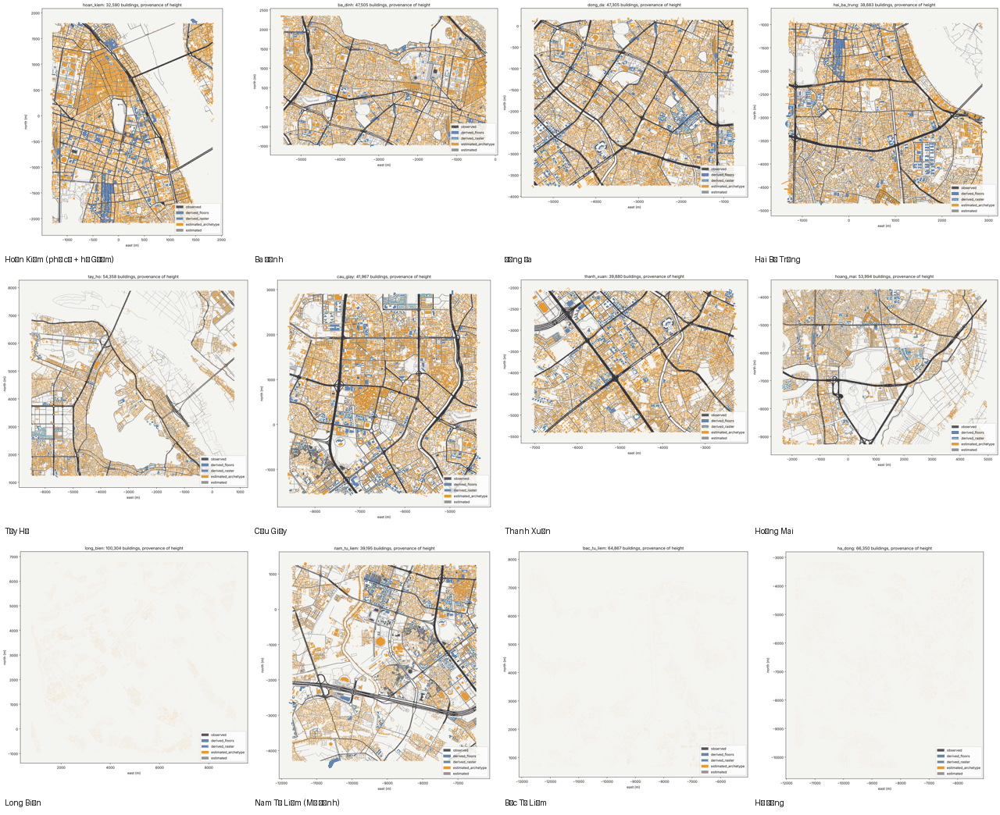

# 11. Mười hai quận nội thành

Dựng ngày 14/10/2026 bằng `python -m pipeline.run_districts` từ một lần tải Overture 2026-09-23.0 cho khung [105.72, 20.93, 105.95, 21.12] (663.712 tòa nhà, 112.829 đoạn đường, tải 2m43s + 1m55s lớp ngữ cảnh), rồi cắt theo quận bằng `pipeline/subset.py` (không tải lại). Mọi quận dùng **một gốc tọa độ** (hồ Gươm, 21.0288, 105.8524) nên `out/<quận>/tiles/*.glb` đặt cạnh nhau là khớp; ô 500 m, khóa ô `ix_iy` tính từ gốc chung, các khung chồng mép nhau nên ô ở ranh giới xuất hiện ở hai quận (importer lấy một).

**Tên quận.** Hà Nội bỏ cấp quận từ 1/7/2025 (phường trực thuộc thành phố). Game vẫn gọi theo quận cũ vì dữ liệu mở, ảnh đường phố và người Hà Nội vẫn nói "Ba Đình", "Cầu Giấy"; các vùng ở đây là *khu vực chơi*, ranh giới là khung chữ nhật trong `pipeline/districts.json`, không phải ranh giới hành chính. Tên phường mới được gắn vào từng tòa nhà qua `semantics/footprints_*.json` (`ward`).

| Quận | Tòa nhà | Ô 500 m | Tam giác | Đường (km) | Nút đèn | Liên thông | Cửa hàng/POI | Đạo cụ PCG | Thời gian |
| --- | ---: | ---: | ---: | ---: | ---: | ---: | ---: | ---: | ---: |
| Hoàn Kiếm (phố cổ + hồ Gươm) | 32,590 | 63 | 1.1 tr | 227 | 227 | 99% | 23,289 | 113,439 | 68 s |
| Ba Đình | 47,505 | 75 | 1.7 tr | 465 | 206 | 99% | 28,718 | 172,090 | 110 s |
| Đống Đa | 47,305 | 90 | 1.6 tr | 538 | 192 | 99% | 40,259 | 194,144 | 112 s |
| Hai Bà Trưng | 38,683 | 79 | 1.5 tr | 452 | 173 | 99% | 20,889 | 141,303 | 64 s |
| Tây Hồ | 54,358 | 205 | 2.0 tr | 682 | 100 | 92% | 15,749 | 231,264 | 109 s |
| Cầu Giấy | 41,967 | 100 | 1.5 tr | 541 | 132 | 99% | 26,060 | 174,067 | 109 s |
| Thanh Xuân | 39,880 | 77 | 1.2 tr | 434 | 57 | 99% | 23,820 | 145,978 | 98 s |
| Hoàng Mai | 53,994 | 180 | 2.2 tr | 830 | 82 | 97% | 14,691 | 221,470 | 104 s |
| Long Biên | 100,304 | 289 | 3.5 tr | 1,134 | 137 | 98% | 11,455 | 395,269 | 222 s |
| Nam Từ Liêm (Mỹ Đình) | 39,195 | 144 | 1.5 tr | 585 | 83 | 99% | 15,636 | 160,554 | 100 s |
| Bắc Từ Liêm | 64,867 | 232 | 2.3 tr | 882 | 92 | 99% | 17,452 | 266,475 | 116 s |
| Hà Đông | 66,350 | 210 | 2.0 tr | 915 | 65 | 99% | 21,399 | 254,768 | 141 s |
| **Tổng** | **626,998** | **1744** | **22 tr** | **7,684** | **1546** | | **259,417** | **2,470,821** | |

Số liệu đọc từ `out/districts.json` (sinh bởi `run_districts.py`); đường km và nút đèn tính trên đồ thị xe chạy được của từng khung nên đoạn đường ở ranh giới được đếm hai lần.

## Kiểu nhà trên toàn nội thành

| Kiểu nhà | Số tòa | Tỷ lệ |
| --- | ---: | ---: |
| `nha_ong_hien_dai` | 466,935 | 74.5% |
| `nha_thap_tang` | 104,084 | 16.6% |
| `lien_ke_kdt` | 28,764 | 4.6% |
| `nha_ong_pho_co` | 10,348 | 1.7% |
| `khu_tap_the` | 6,770 | 1.1% |
| `cong_trinh_cong_cong` | 4,397 | 0.7% |
| `biet_thu_phap` | 2,826 | 0.5% |
| `van_phong_cao_tang` | 1,084 | 0.2% |
| `dinh_chua` | 511 | 0.1% |
| `nha_xuong` | 505 | 0.1% |
| `cong_trinh_phap_cong` | 485 | 0.1% |
| `chung_cu_cao_tang` | 244 | 0.0% |
| `cho` | 45 | 0.0% |

Phân loại theo luật trong `pipeline/semantics.py` với vùng phố cổ / phố Pháp vẽ tay; ngoài lõi, `lien_ke_kdt` nhận ra dãy nhà đều của khu đô thị mới (Linh Đàm, Văn Quán, Mỹ Đình), `khu_tap_the` nhận ra nhà tấm lớn ở Kim Liên, Thành Công, Giảng Võ, Thanh Xuân Bắc. Cần người kiểm mẫu ở mỗi quận (xem `07-qc-checklist.md`).

## Đạo cụ theo quận

`game/assets/asset_specs.json` mục `district_sets` ghi bộ đạo cụ cần cho mỗi quận (bộ sẵn có + 11 bộ mới: `metro_rail`, `national_rail`, `river_dike`, `lakeside`, `rooftop_clutter`, `kdt_moi`, `road_structures`, `ktt_addons`, `lang_trong_pho`, `cho_coc`, `pavement_clutter`); các bộ mới chưa được bước `scatter` rải tự động, mới có hợp đồng kích thước và prompt tham chiếu (`08-nguon-tai-san-3d.md`).

## Xem trước

Từng quận: `out/<quận>/preview.png` (khối nhà) và `preview_semantic.png` (kiểu nhà, mặt tiền, đạo cụ quanh tâm quận). Ba quận trên 60.000 tòa nhà (Long Biên, Bắc Từ Liêm, Hà Đông) được `build.py` vẽ xem trước ở chế độ thô nên ảnh nhạt; số tòa nhà và ô trong bảng là số thật từ `manifest.json`.

## Hạn chế đã biết

- Hơn 98% tòa nhà không có chiều cao gốc trong Overture, nên chung cư và văn phòng cao tầng ngoài lõi bị xếp vào `nha_thap_tang`/`nha_ong_hien_dai` (toàn nội thành chỉ nhận ra 244 `chung_cu_cao_tang`). Cần lớp chiều cao bổ sung (raster 2.5D, `build.py --heights-tif`) hoặc luật theo diện tích đế + tên dự án trước khi dựng Linh Đàm, Mỹ Đình, Times City.
- Khung Tây Hồ, Long Biên gồm nhiều mặt nước và bãi sông nên tỷ lệ liên thông đồ thị đường thấp hơn (92-98%).

## Chưa làm

- Huyện ngoại thành (Gia Lâm, Đông Anh, Thanh Trì, Hoài Đức): khung đã ghi ở `pipeline/districts.json` mục `later`, cần một lần tải riêng vì nằm ngoài khung cache.
- Ghép 12 bộ ô thành một thế giới trong UE5: importer đọc `out/districts.json` để lấy danh sách; trùng ô ở mép lấy quận đứng trước.
- Sông Hồng, Hồ Tây làm mặt nước: lớp `water.parquet` đã có trong cache, chưa xuất mesh.
