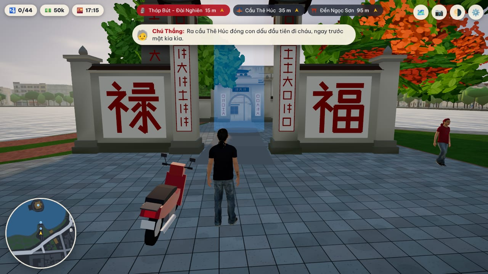
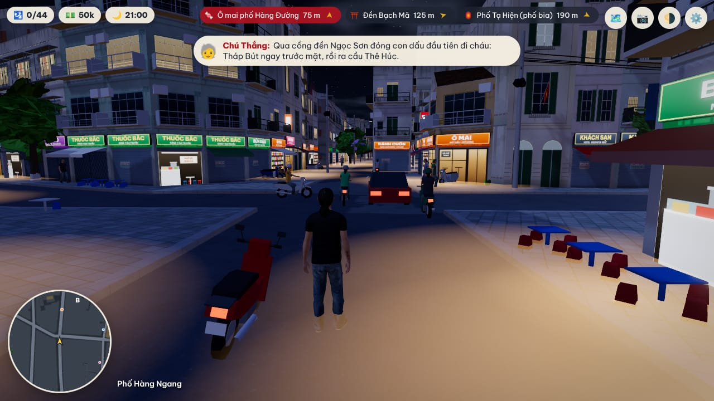
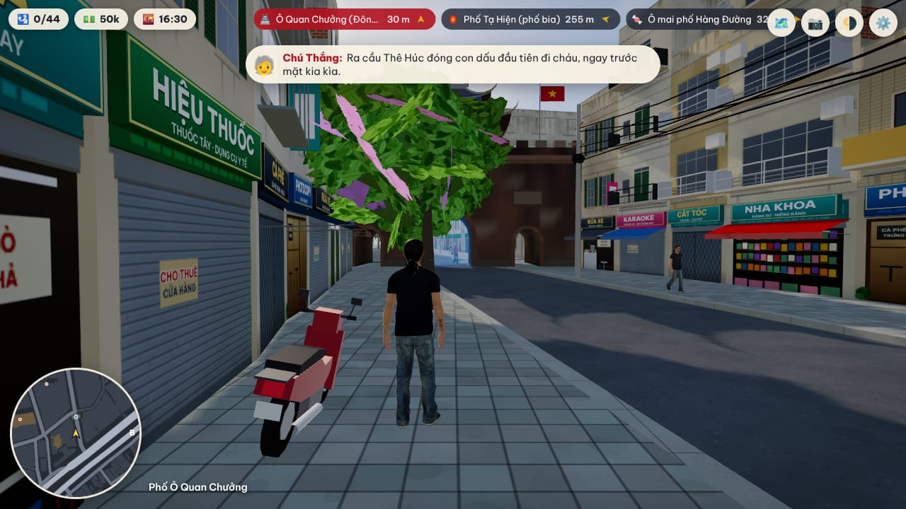
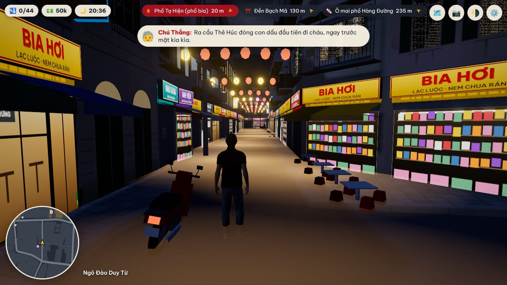

# 17. Bản web three.js: "Hà Nội Dạo Phố" (bản 2, dựng lại từ đầu)

Game chơi ngay trên trình duyệt để quảng bá du lịch Hà Nội: bạn là Minh, chạy xe ôm phố cổ, dạo bộ quanh
Hồ Gươm, lên xe luồn qua dòng xe máy, chở khách, ăn phở và đóng đầy cuốn hộ chiếu Hà Nội. Không cướp bóc,
không bắn súng, không thua. Mã nguồn ở `web/`, bản chạy được đưa lên GitHub Pages khi vào `main`:
<https://vansyson1308.github.io/vncity/>.

| | |
|---|---|
|  |  |
|  |  |

Ảnh chụp từ bản build trong Chromium không có GPU (SwiftShader), mức Vừa và Đẹp.

## 1. Vì sao dựng lại

Bản 1 (tháng 10/2026) giật và "không giống Hà Nội". Nguyên nhân và cách bản 2 xử lý:

| Vấn đề của bản 1 | Bản 2 |
|---|---|
| Tải 21 MB mô hình, ảnh từ repo khác (craft-anything) | Không tải ảnh nào. Mọi chất liệu, nhà, cây, xe, công trình đều dựng thủ tục khi chạy. Tổng tải khoảng 2,6 MB (bản đồ 0,7 MB nén, mã 0,3 MB, ba bản mô hình người 1,6 MB) |
| Dựng 15.000 nhà trên luồng chính lúc tải, đứng hình vài giây | Thành phố chia ô 128 m. Một Web Worker sinh lưới cho từng ô quanh người chơi (gần trước, xa sau), luồng chính chỉ nạp mảng vào GPU. Vòng lặp vẽ không bao giờ dừng để tính hình học |
| Bóng 4096² vẽ lại toàn cảnh mỗi khung hình, 12 đèn điểm ban đêm, hậu kỳ toàn màn hình ở tỉ lệ điểm ảnh 1,75 | Bóng 2048² chỉ phủ 75 m quanh người chơi, cập nhật cách khung. Đèn đêm là phát sáng + một bản đồ ánh sáng nhìn từ trên xuống (mọi cột đèn, cửa hàng cộng vào một texture quanh người chơi; mặt đất và đồ vật nhân độ sáng với nó, tổng được nén mềm nên không cháy), không có đèn điểm. Độ phân giải động giữ 60 khung hình/giây, kèm bộ điều tiết giảm dần mật độ cảnh khi máy yếu |
| Mỗi xe máy, mỗi người là một lưới có xương riêng | Mỗi loại xe một `InstancedMesh` (người lái nướng sẵn vào lưới xe). Người đi bộ dùng skinning trên GPU từ texture hoạt hình, ba lệnh vẽ cho cả đám đông |
| Chỉ có quận Hoàn Kiếm, mặt tiền là ảnh dán lặp quanh khối nhà, 4 công trình có mô hình | 12 km² trung tâm: Hồ Gươm, 36 phố phường, khu phố Pháp, Ba Đình, Văn Miếu, mép nam Hồ Tây, đầu cầu Long Biên. 29.637 toà nhà đúng vị trí, mặt tiền chia gian theo kiểu nhà ống, biển hiệu theo đúng nghề của từng phố, 15 công trình dựng tay |
| Mặt đất phẳng, đường là dải vẽ đè lên nền | Lòng đường thấp hơn vỉa hè 16 cm, có bó vỉa đá, góc phố bo tròn, kè hồ, vạch sơn, vạch sang đường |

## 2. Thiết kế theo "The Art of Game Design" (Jesse Schell)

Cả cuốn sách (100 lăng kính) được đọc và rút thành các quyết định cụ thể dưới đây.

| Lăng kính | Quyết định trong game |
|---|---|
| #1 Trải nghiệm cốt lõi, #9 Thống nhất | Game không "nói về Hà Nội" mà là "một buổi chiều tối thong dong ở Hà Nội". Mọi thứ không phục vụ câu đó bị cắt: không xăng, không hỏng xe, không phạt, không đồng hồ đếm ngược |
| #15 Đồ chơi | Chạy xe giữa dòng xe phải vui ngay cả khi không có mục tiêu: xe nghiêng khi vào cua, máy nổ theo ga, bóp còi thì xe trước dạt ra, đi bộ sang đường thì dòng xe tự chảy quanh |
| #61 Đường cong hứng thú | Mở đầu ở Bờ Hồ lúc chiều vàng, trước cổng đền Ngọc Sơn; con dấu đầu tiên cách 15 m. Sau đó lên xe, vào phố cổ, bát phở đầu tiên. Đồng hồ game chạy sao cho phố lên đèn vào khoảng phút thứ tám |
| #25 Mục tiêu, #49 Tiến độ nhìn thấy được | Một câu mục tiêu ở màn hình đầu: "Đóng đầy cuốn hộ chiếu Hà Nội". Hộ chiếu chia năm trang theo khu, dấu chưa có hiện "? ? ?", luôn thấy x/44 |
| #71 Tự do, #72 Điều khiển gián tiếp | La bàn chỉ hiện ba gợi ý gần nhất, ưu tiên khác loại (địa danh, món ăn, văn hoá), không liệt kê hết. Cột sáng nhìn thấy từ xa. Thẻ địa danh kết bằng "Gần đây: ..." để gieo câu hỏi tiếp theo |
| #73 Thông đồng | Khách xe ôm luôn xin tới gần một điểm chưa đóng dấu, nên mỗi cuốc xe dẫn tới một nơi mới |
| #40 Phần thưởng, #41 Trừng phạt | Không có thất bại. Đâm vào tường chỉ khựng lại, lảo đảo và kêu "Ối!". Đi xóc thì khách chấm ít sao, tiền thưởng ít hơn; dấu không bao giờ mất |
| #5 Giá trị nội sinh, #46 Kinh tế | Địa danh cho tiền mừng, cuốc xe cho tiền công, tiền để ăn các món (mỗi món là một con dấu). Tiền không bao giờ chặn đường: chỉ riêng tiền mừng đã đủ ăn hết |
| #55-#60 Giao diện | Thế giới là chính. HUD chỉ có hộ chiếu, ví, giờ, la bàn, bản đồ nhỏ; đồng hồ cuốc xe chỉ hiện khi chở khách. Thẻ địa danh hai dòng, không chặn màn hình, bấm E mới mở rộng. Ba chế độ (đi bộ, lái xe, chở khách) dùng chung cách điều khiển |
| #58 Độ "mọng" | Đóng dấu: tiếng "cộp", dấu đỏ đập xuống thẻ, tiếng chuông, tiền mừng, điện thoại rung |
| #76-#81 Nhân vật | Một người dẫn duy nhất là chú Thắng, xe ôm lão làng: vừa hướng dẫn, vừa khen, vừa thưởng, bằng các lời nhắn ngắn theo tình huống |
| #92 Công nghệ | Nền móng là: mở liên kết là chơi, bản đồ thật, dòng xe máy. Phần còn lại (bóng, hậu kỳ) là trang trí và tự tắt được |
| #97 Biến đổi, #98 Trách nhiệm | Người chơi rời game biết đi từ Bờ Hồ lên chợ Đồng Xuân, biết sang đường kiểu Hà Nội, biết bảy món nên thử. Không thưởng cho việc đâm người; khu vực trang nghiêm (Lăng Bác, quảng trường Ba Đình, Phủ Chủ tịch) phải dắt xe, không nhận cuốc, không bóp còi; quanh đó không có biển hiệu, quán cóc, xe đỗ hay nhà suy đoán. Chứng nhận cuối cùng mời người chơi tới Hà Nội thật |

## 3. Dữ liệu và giấy phép

| Nguồn | Dùng gì | Giấy phép |
|---|---|---|
| OpenStreetMap, tải qua API chính thức (`web/tools/fetch_osm.mjs`) | 18.807 toà nhà, 8.154 đoạn đường có tên và bề rộng, hồ, sông Hồng, công viên, 3.510 cây, tường rào, đường sắt, 1.561 vị trí hàng ăn uống (chỉ lấy vị trí, không lấy tên quán) | ODbL 1.0, ghi "© OpenStreetMap" trong game |
| Overture Maps 2026-09-23.0 (`web/tools/fetch_overture.py`) | 10.830 toà nhà do máy học vẽ ở những ô phố OSM chưa vẽ nhà | Microsoft ML Buildings: ODbL. Google Open Buildings: CC BY 4.0 |
| `game/content/world/landmarks.json` | 36 địa danh và con phố nằm trong khung bản đồ, tên và mô tả song ngữ, toạ độ đã kiểm chứng với OSM (docs/15) | Nội dung của dự án |
| `web/content/foods.json` | 7 món ăn + phố đèn lồng Hàng Mã, chỉ ghi món và phố, không ghi tên quán | Nội dung của dự án |
| `viewer/assets/walker.glb` | Mô hình người có bốn đoạn hoạt hình (đứng, đi, chạy bộ, chạy) cho Minh, người đi bộ, người lái xe | Microsoft Rocketbox, MIT (`web/public/models/ROCKETBOX_LICENSE.md`) |
| Be Vietnam Pro (`@fontsource`) | Phông chữ giao diện và biển hiệu, tự lưu trữ, không gọi máy chủ ngoài | OFL 1.1 |

Kết quả xử lý (`web/public/world/hanoi.json`, `places.json`, `web/public/models/*.glb`) được commit, nên CI và
người chơi không cần mạng tới OSM hay Overture. Biển hiệu chỉ ghi ngành hàng theo truyền thống phố nghề (Hàng Bạc
bán vàng bạc, Hàng Mã bán đồ mã, Lãn Ông bán thuốc bắc...), không có tên cửa hàng hay thương hiệu thật.

## 4. Kiến trúc

```
tools/fetch_osm.mjs ─┐
tools/fetch_overture.py ─┴─> tools/build_world.mjs ──> public/world/hanoi.json (2 MB, 0,7 MB khi nén)
game/content/world/landmarks.json + content/foods.json ──> tools/build_places.mjs ──> public/world/places.json

Trình duyệt
  luồng chính: main.js ── renderer, bầu trời, người chơi, dòng xe, đám đông, lối chơi, giao diện, âm thanh
       │  yêu cầu ô (cx, cz)                    ▲ mảng đỉnh (chuyển quyền sở hữu, không sao chép)
       ▼                                        │
  worker: world/worker.js ── gen/ground.js   lòng đường, vỉa hè, bó vỉa, cỏ, kè hồ, vạch sơn (Clipper + earcut)
                             gen/buildings.js tường chia gian, mái ngói dốc, va chạm
                             gen/props.js     cây, đèn đường
                             gen/decor.js     biển hiệu, mái hiên, ban công, dây điện, xe đỗ, quán cóc, bồn nước, tường rào
                             gen/mapdraw.js   ảnh bản đồ (OffscreenCanvas)
```

Các kỹ thuật chính:

1. **Mặt đất bằng phép toán đa giác.** Mỗi đoạn đường được đệm theo bề rộng rồi gộp lại (Clipper); phần còn
   lại của ô là khối phố. Nhờ đó vỉa hè nâng 16 cm, bó vỉa, góc phố bo tròn và kè hồ đều là hình học thật. Bề
   rộng đường được thu theo khoảng trống thật giữa hai dãy nhà (`build_world.mjs`) nên đường không ăn vào mặt tiền.
2. **Mặt tiền nhà ống trong một lệnh vẽ.** 40 lớp mặt đứng (một gian × một tầng: ban công sắt, cửa chớp,
   chuồng cọp, cửa cuốn, quán phở, biệt thự Pháp, tập thể...) vẽ bằng canvas, gói thành `sampler2DArray`. Worker
   chia tường mặt phố thành từng gian và chọn lớp, màu vôi, màu biển cho từng gian; shader chỉ việc vẽ theo.
   Tường giáp nhà bên là tường trơn; khuất hẳn sau nhà cao hơn thì không sinh ra.
3. **Hai mức chi tiết cho đồ vật.** Mỗi ô có lưới "gần" (cây đủ tán lá, biển hiệu nổi, ban công, dây điện, xe
   đỗ) và lưới "xa" (cây một khối, cột đèn bốn cạnh). Xe trong dòng xe cũng có bản xa vài khối hộp.
4. **Ánh sáng không cần bản đồ môi trường.** Kính, mặt hồ, nước sơn xe tự tính phản chiếu trời từ cùng bộ
   uniform với vòm trời, nên đổi giờ không tốn khung hình nào để dựng cubemap.
5. **Nền trước, chi tiết sau.** Ô ở xa chỉ có nền (mặt đất, nhà, đồ vật bản xa); lưới chi tiết chỉ được worker gửi khi
   người chơi tới gần và bị gỡ khi đi xa, nên tầm nhìn tới 760 m mà bộ nhớ GPU vẫn nhỏ.
6. **Va chạm bằng đoạn thẳng.** Tường nhà, tường rào, bờ nước là các đoạn 2D trong lưới 16 m của từng ô; người
   và xe là vòng tròn bị đẩy ra. Cầu Thê Húc là "mặt cầu" đi bộ được có vòm.
7. **Cầu có độ cao thật, tính từ một hàm duy nhất.** Các đoạn đường gắn thẻ cầu nối liền nhau thành một cây cầu;
   cầu dài từ 150 m được nâng lên: dốc 6,5% từ chỗ nối với đường thường tới độ cao mặt cầu (Long Biên 9 m, Chương
   Dương và vòng xoay đầu cầu 8 m, cầu vượt An Dương 6 m) rồi đi ngang. Hàm `roadY` trong `world/data.js` chạy ở cả
   worker (dựng mặt cầu, tường chắn dốc, dầm, lan can, trụ, cầu dẫn đường sắt) lẫn luồng chính (cao độ người chơi,
   dòng xe, va chạm với lan can), nên hình và vật lý không thể lệch nhau. Nước sông chảy dưới gầm cầu, phố dưới gầm
   cầu vẫn đi lại được, nhà bị cầu cắt ngang trong dữ liệu thì bỏ. `tools/gen_check.mjs` đi dọc cả 19 đoạn cầu bằng
   chính hàm điều hướng của game và báo lỗi nếu cao độ lệch hay rơi khỏi cầu.
8. **Chi tiết bề mặt không tốn dung lượng tải.** Mười chất liệu (gạch, đá xẻ, vữa vôi cũ, ngói, gỗ, thép gỉ, bê
   tông, đá rêu, gạch lát sân, sơn son) được shader vẽ ra từ vị trí và pháp tuyến của điểm trong hệ toạ độ mô hình
   (`world/detail.js`): không cần UV, không cần ảnh. Mô hình chỉ gọi `g.mat(MAT.brick)`. Ở xa, hoa văn tự hoà về màu
   trung bình nên không nhấp nháy. Công trình biểu tượng được đèn pha hắt sáng ban đêm ngay trong shader.
9. **Vật lý theo đơn vị thật.** `actors/physics.js` mô hình hoá chiếc xe số 110 cc bằng số đo ngoài đời: khối lượng xe
   và người (chở khách thì nặng thêm 58 kg), lực kéo giới hạn bởi công suất 4,8 kW tại bánh, cản lăn, cản gió tỉ lệ v²,
   lực hãm của máy khi nhả ga, phanh giới hạn bởi độ bám của lốp (0,75 khô, 0,5 ướt) theo vòng tròn ma sát, trọng lực
   trên dốc cầu. Xe rẽ nhờ nghiêng: v²·κ = g·tan φ, nghiêng tối đa 35°, ngả xe không quá 1,7 rad/s, nên vào cua gắt phải
   giảm tốc như ngoài đời. Đâm tường mất thành phần vận tốc vuông góc; va vào xe khác tính theo bảo toàn động lượng
   (ô tô 1,35 tấn gần như không suy suyển, xe máy thì cả hai cùng khựng). Người đi bộ 5,2 km/h, chạy 16 km/h, gia tốc
   có hạn. `tools/physics_check.mjs` mô phỏng 25 phép thử (0 đến 40 km/h trong 4,2 giây, tối đa 81 km/h, phanh
   40 về 0 trong 7,8 m...) và báo lỗi nếu lệch khỏi khoảng đo thực tế.
10. **Lối đi được kiểm chứng.** Tường rào để hở ở cổng thật (nút cổng của OSM) và ở mọi chỗ có lối đi cắt qua. Công
   trình dựng tay khai báo lối phải thông (`paths`) và khối đặc (`solid`); công trình kín lấy mặt bằng của chính mô
   hình làm va chạm. `tools/reach_check.mjs` loang trên lưới 0,4 m bằng đúng hàm va chạm của game để chắc rằng cả 44
   điểm hộ chiếu đều tới được từ mạng đường; `tools/build_places.mjs` dùng cùng thư viện đó để dời điểm đóng dấu về
   chỗ tới được và tính sẵn chỗ đứng thoáng cho chức năng đi nhanh.
11. **Camera không vượt tường.** Tia từ đầu nhân vật tới vị trí camera (đã cộng độ lệch ngang) dừng trước mọi bức tường
   0,35 m; camera còn được đẩy như một vòng tròn 0,5 m để mặt cắt gần của ống kính không cắt vào nhà; bị dồn vào góc
   thì áp sát đầu nhân vật và nhân vật được ẩn đi. Cột cổng, thân cây, mái hiên, tán lá chắn giữa camera và nhân vật thì
   mờ đi ngay trong shader (mẫu chấm Bayer đều, bám theo màn hình) để vẫn thấy nhân vật; đồ vật và lá áp sát ống kính
   cũng tan đi trong một bán kính nhỏ quanh camera, nên không bao giờ có một chiếc lá che kín màn hình
   (`world/materials.js`, mục CUT).
12. **Âm thanh tổng hợp.** Không tải tệp âm thanh nào: tiếng máy theo vòng tua và hộp số bốn cấp, gió, phanh, bước
   chân, nền phố ngày và đêm, nhạc ngũ cung tự sáng tác với ba âm sắc gợi đàn bầu, đàn tranh, sáo trúc
   (`audio/audio.js`, ghi công trong `CREDITS.md`).
13. **Biển tên phố bằng tên thật.** Cả 761 tên đường trong bản đồ được vẽ một lần lúc khởi động vào một atlas một kênh
   (4096², mức Nhẹ 2048²); vị trí từng ô tính từ danh sách tên đã sắp xếp nên worker và luồng chính luôn ra cùng kết
   quả mà không phải truyền gì cho nhau (`world/streetnames.js`, `streetatlas.js`). Mỗi ô phố chi tiết có thêm đúng một
   lưới cho biển tên, đèn tín hiệu và các bảng chữ của đồ đạc phố (`gen/furniture.js`).
14. **Một nguồn sự thật cho đèn tín hiệu.** `world/junctions.js` tính một lần nút nào có đèn, nhánh nào thuộc pha nào và
   chu kỳ (xanh 23, vàng 3, đỏ 30 giây). Shader vẽ bóng đèn và số đếm ngược, còn dòng xe (`actors/trafficsim.js`) hỏi
   đúng hàm đó với cùng đồng hồ, nên xe dừng khi người chơi thấy đèn đỏ. Nhánh vào nút quá ngắn thì xe dừng từ đoạn
   đường trước đó.
15. **Dòng xe tách ba lớp.** `trafficsim.js` là mô phỏng thuần (chạy được trong Node, có bài thử bằng số
   `tools/traffic_check.mjs`: cơ cấu xe theo khu và giờ, tốc độ, số xe kẹt, xe đè lên nhau, xe né người qua đường);
   `fleet.js` vẽ bằng instancing (mỗi loại xe và mỗi mức chi tiết một lệnh vẽ, quầng đèn đêm của mọi xe chung một lệnh
   vẽ); `traffic.js` nối hai bên. Đường mang thêm hai cờ lấy từ thẻ OSM: cấm ô tô (ngõ nhỏ, cầu Long Biên, làn xe máy
   cầu Chương Dương) và cấm xe máy (lòng giữa cầu Chương Dương).
16. **Nhà ống theo từng lô.** Khối nhà liền dãy của OSM được cắt thành các lô rộng 2,9 đến 5,3 m, mỗi lô có số tầng, màu,
   tuổi nhà và kiểu mái riêng (`gen/buildings.js`); 40 lớp mặt đứng; biển hiệu theo quy tắc phố cổ (dải tầng trệt, cao
   không quá 0,8 m, có biển vẫy). Bảng `gen/heroes.js` đặt chiều cao, màu và một nét nhận diện cho 28 toà nhà có tên.
17. **Không khí Hà Nội.** Trời mù trắng xám là mặc định, có bốn kiểu thời tiết (`?weather=mu|thu|he|nom`). Sương hoà mọi
   điểm ảnh ở xa vào đúng màu trời phía sau nó, ban đêm trời hửng nâu xám vì đèn thành phố nên cảnh xa không còn đen.
   Mặt hè đổi theo khu (đá granite quanh Hồ Gươm, đá xanh xám ở phố chính, gạch đỏ hoặc terrazzo ở nơi khác), bó vỉa
   vát có rãnh và miệng thu nước, ô cây, nắp hố ga, vạch sơn mòn; vũng sáng dưới đèn làm sáng chất liệu mặt đất thay
   vì phủ trắng lên nó (`engine/sky.js`, `world/textures.js`, `gen/ground.js`, `gen/pits.js`). Cây đổi lá, ra hoa theo
   mùa của thời tiết (mặc định `mu` là đông: phượng, bằng lăng chỉ còn lá, bàng lá đỏ; `he` là hè: phượng đỏ, bằng lăng
   tím); cây sát mép nước ngả tán ra mặt hồ, gốc vẫn trên bờ (`models/street.js` SEASON, `gen/props.js`).
18. **Cầu Chương Dương đúng mặt cắt.** Bộ dựng bản đồ nắn ba tuyến của cầu thành lòng ô tô 10,4 m ở giữa và hai làn xe
   máy 3,4 m hai bên, chừa khe 0,4 m cho hai mặt phẳng dàn thép (`landmarks/cau_chuong_duong.js`); trụ cầu đứng đúng
   đầu mỗi nhịp dàn. Người chơi không đi xuyên dàn được vì hai mặt cầu không liền nhau.
19. **Phố đi bộ tối cuối tuần.** Game có thứ trong tuần (mở đầu là chiều thứ Năm, đồng hồ ghi thứ; tua giờ qua nửa đêm thì
   sang ngày mới). Từ 19 giờ tới nửa đêm thứ Sáu, thứ Bảy, Chủ nhật, vòng quanh Hồ Gươm, các phố nhỏ phía đông hồ và trục chợ
   đêm Hàng Đào - Đồng Xuân đóng lại (`world/walkzone.js`): dòng xe không vào, chiều chạy nào chỉ dẫn tới rào cũng không nhận
   xe (để không dồn ứ trước rào), xe còn sót tự chạy ra; rào chắn dựng ở 35 đầu phố (`world/walkstreet.js`); người đi bộ đi
   cả dưới lòng đường và đông gấp rưỡi; người chơi không chạy xe được sau rào; cuốc xe ôm không đón trả trong khu.

## 5. Hiệu năng

Ngân sách, được CI kiểm (`tools/gen_check.mjs`, `tools/smoke.mjs`):

| Đại lượng | Ngân sách | Đo được (11/11/2026) |
|---|---|---|
| Lệnh vẽ mỗi khung hình, mức Nhẹ | dưới 260 | 76 đến 80 (Bờ Hồ, Hàng Mã đêm, Ba Đình) |
| Tam giác mỗi khung hình, mức Nhẹ | dưới 700 nghìn | 88 đến 150 nghìn |
| Lệnh vẽ, tam giác mức Đẹp (tính cả lượt vẽ bóng) | | 144 đến 228 lệnh vẽ, 210 đến 500 nghìn tam giác |
| Thời gian JavaScript mỗi khung hình (xe, người, lối chơi, giao diện) | dưới 4 ms | 0,7 đến 2,2 ms |
| Tam giác lưới "gần" của ô dày nhất | dưới 70 nghìn | 55.154 |
| Thời gian worker sinh một ô (không chặn khung hình) | | trung bình 24 ms, chậm nhất 111 ms |

Ba lớp bảo vệ khung hình, theo thứ tự:

1. **Mức chất lượng** (`src/config.js`): Nhẹ, Vừa, Đẹp, tự chọn theo máy, đổi được trong ⚙️.
2. **Độ phân giải động** (`engine/renderer.js`): khung hình vượt 21 ms thì giảm tỉ lệ điểm ảnh, dư thì tăng lại.
3. **Bộ điều tiết** (`engine/governor.js`): đã hạ hết độ phân giải mà vẫn dưới 45 khung hình/giây thì bớt xe và
   người, thu hẹp vùng chi tiết, thưa cập nhật bóng, cuối cùng tắt bóng.

Giới hạn của phép đo: môi trường dựng và CI không có GPU (Chromium chạy SwiftShader, tức là CPU tự vẽ từng điểm ảnh;
ở đó mức Nhẹ đạt 1 đến 5 khung hình/giây), nên số khung hình/giây trên máy thật chưa được đo ở đây. Các con số trên là số lệnh vẽ, số tam giác và thời gian JavaScript, là những
thứ quyết định độ mượt và đo được khách quan. Nên chạy thử trên vài máy và điện thoại thật trước khi quảng bá.

## 6. Lối chơi

- **Hộ chiếu**: 44 điểm chia năm trang (Hồ Gươm, Phố cổ, Khu phố Pháp, Ba Đình, Hồ Tây). Tới địa danh là đóng
  dấu và nhận 20k tiền mừng; đủ một trang thưởng 50k. Món ăn phải dừng lại bấm E và trả tiền (15k tới 45k).
- **Xe máy** (F): ga, phanh, lái; Shift tăng ga; Space bóp còi. Xe ở xa thì Minh tự dắt lại.
- **Xe ôm**: khách đứng vẫy ở vòng vàng, tạt vào bấm E để đón, chở tới vòng xanh. Tiền công theo quãng đường,
  thưởng theo độ êm. Ba hạng: xe ôm phố cổ (3 cuốc), xe ôm thạo đường (10), thổ địa Hà Nội (25).
- **Giờ trong ngày** chạy liên tục (một giờ game dài sáu phút); N để nhảy tới sáng, trưa, chiều vàng, đêm.
- **Bản đồ** (M): bấm vào điểm đã có dấu để đi nhanh. **Chụp ảnh** (P): ẩn giao diện, Enter để lưu ảnh.
- **Song ngữ** Việt, Anh (L hoặc ⚙️). **Điện thoại**: nửa trái màn hình là cần điều khiển, nửa phải để nhìn.
- Tiến độ, vị trí, giờ và cài đặt lưu trong trình duyệt. Không quảng cáo, không thu thập dữ liệu.

## 7. Chạy trên máy

```sh
cd web
npm ci
npm run dev        # http://localhost:5173
npm run check      # dựng thử cả 756 ô phố bằng Node, kiểm ngân sách tam giác
npm run build      # ra web/dist
node tools/smoke.mjs   # kiểm thử khói trong Chromium (đặt CHROME_PATH nếu Playwright không có sẵn trình duyệt)
npm run lint           # biến chưa khai báo, khai báo trùng
npm run physics        # 25 phép thử vật lý so với số đo ngoài đời
node tools/traffic_check.mjs   # dòng xe bằng số: cơ cấu, tốc độ, kẹt, xe đè lên nhau, né người qua đường
npm run reach          # cả 44 điểm hộ chiếu có lối đi tới
node tools/accept.mjs  # nghiệm thu trên trình duyệt: đi bộ qua cầu Thê Húc, xoay camera sát tường, đi nhanh 44 điểm,
                       # khách ngồi sau, HUD 1140 × 670, âm thanh và hai công tắc, các lỗi nhẹ (chạy lâu, không nằm trong CI)
```

Làm mới dữ liệu (không cần cho build thường ngày):

```sh
npm run world                          # tải lại OSM, dựng lại hanoi.json và places.json
pip install duckdb && python tools/fetch_overture.py && node tools/build_world.mjs   # thêm nhà Overture
npm run places                         # sau khi sửa landmarks.json hoặc content/foods.json
npm run assets                         # sau khi đổi viewer/assets/walker.glb
```

Tham số đường dẫn để chụp ảnh và dò lỗi: `?q=low|medium|high`, `?h=17.2` (cố định giờ), `?street=Phố Hàng Mã`,
`?at=x,z` (mét, gốc ở Hồ Gươm, x hướng đông, z hướng nam), `?yaw=`, `?bike`, `?lang=en`, `?fresh` (bỏ vị trí đã
lưu), `?shot` (bỏ màn hình chào), `?debug` (hiện số liệu khung hình), `?site=id` (đứng trước một công trình),
`?weather=mu|thu|he|nom`, `?day=0..6` (thứ trong tuần, 0 là thứ Hai; `?day=5&h=20` là tối thứ Bảy có phố đi bộ). `node tools/shot.mjs out.png "h=17.2&street=Phố Hàng Đào"` chụp ảnh trong game không cần build;
`node tools/hours.mjs` chụp 24 giờ tại một chỗ để soát màu trời.

### Xưởng vẽ: công cụ dựng và soát mô hình

Game không tải mô hình cảnh nào, nên "phần mềm vẽ" của dự án là mã: bộ dựng hình `G`, chất liệu chi tiết `MAT`, và
xưởng vẽ để nhìn, đo, soát lỗi từng mô hình bằng đúng vật liệu và ánh sáng của game.

```sh
node tools/studio.mjs                          # soát lỗi mọi mô hình (thuần Node, chạy trong CI)
node tools/studio.mjs lm:nha_tho_lon --verbose # một mô hình, in toạ độ các mặt trùng nhau
node tools/studio.mjs --shots out/ lm:thap_rua # chụp bảng 6 góc: 3/4, chính diện, mặt bên, ban đêm, hai cận cảnh
```

- Trang `/dev/studio.html?m=lm:thap_rua` (khi chạy `npm run dev`): lưới sàn 1 m, người mẫu cao 1,7 m để so tỉ lệ,
  `&tags` tô màu theo chất liệu, `&wire` khung lưới, `&view=hero&zoom=x,y,z,r` soi gần một điểm, `&h=20.5` đổi giờ.
  `?m=mats` là bảng mẫu mười chất liệu.
- Bộ soát (`dev/lint.js`): số tam giác so với ngân sách (8.000 mỗi công trình), kích thước, điểm thấp nhất (lơ lửng
  hay chìm), tam giác suy biến, diện tích các mặt cùng phẳng khác màu chồng lên nhau (nguyên nhân nhấp nháy khi
  nhìn xa), tỉ lệ bề mặt chưa gắn chất liệu.
- Quy trình thêm hoặc sửa một mô hình: sửa tệp trong `src/world/landmarks/` hoặc `src/models/`, chạy soát lỗi, chụp
  bảng 6 góc, nhìn và sửa tiếp. Mọi mô hình trong game đều đã qua vòng này.

## 8. Cấu trúc mã (`web/src`)

| Thư mục | Việc |
|---|---|
| `core/` | `geo.js` bộ dựng hình thủ tục `G` (chạy được trong worker), `util.js` |
| `engine/` | renderer + hậu kỳ + độ phân giải động, bầu trời và giờ trong ngày, camera góc ba, điều khiển (bàn phím, chuột, cảm ứng, tay cầm), bộ điều tiết |
| `world/` | giải mã bản đồ và cao độ cầu (`data.js`), worker và các bộ sinh `gen/`, chất liệu vẽ thủ tục, chất liệu chi tiết (`detail.js`), mặt đứng, biển hiệu, quản lý ô phố, va chạm |
| `world/landmarks/` | 15 công trình dựng tay (14 đặt theo `sites.js`, cầu Long Biên dựng dọc tuyến cầu) |
| `models/` | cây, đèn, đồ đạc phố (cột biển, đèn tín hiệu, tủ điện, nhà chờ, rào công trường), xe máy, ô tô, xe buýt, xe đạp, xích lô, xe điện du lịch |
| `actors/` | Minh, dòng xe (`trafficsim.js`, `fleet.js`, `traffic.js`), người đi bộ theo vai (`crowd.js`, `cast.js`), nướng hoạt hình |
| `game/` | hộ chiếu, cuốc xe ôm |
| `ui/`, `audio/` | giao diện DOM, bản đồ, chữ song ngữ; âm thanh tổng hợp bằng WebAudio |
| `../dev/`, `../tools/studio.mjs` | xưởng vẽ: trang soi mô hình, bộ soát lỗi, danh mục mô hình |

## 9. Giới hạn hiện tại

- Đây là game trình duyệt dựng thủ tục, không phải GTA VI: nhà và công trình là hình học đơn giản có màu đỉnh và
  chất liệu vẽ bằng canvas, không có ảnh chụp hay quét 3D. Đúng về bố cục, tỉ lệ, màu sắc; chưa đúng tới từng
  chi tiết của từng ngôi nhà.
- Mọi người đi bộ và người lái xe dùng chung một mô hình (khác màu áo, chiều cao, nón); chưa có nữ, trẻ em,
  người già riêng.
- Cầu đã có độ cao thật nhưng kết cấu còn giản lược: dàn thép Chương Dương dựng theo ước lượng (nhịp 89 m, cao 10 m,
  chưa đối chiếu bản vẽ), trụ cầu là trụ tường đơn giản; mặt cầu Long Biên là bản đặc chứ chưa phải sàn thép hở; dốc
  cầu gãy góc nhẹ ở đỉnh dốc. Cầu cạn đường
  sắt qua phố Phùng Hưng (ngoài đoạn dẫn lên cầu Long Biên) chưa dựng. Người đi bộ chưa lên cầu. Bản đồ dừng ở giữa
  sông: chạy hết cầu là gặp mép bản đồ.
- Chưa có giọng nói, tiếng rao thật; mọi âm thanh và nhạc nền là tổng hợp (không tìm được bản thu nào vừa hợp vừa có
  giấy phép dùng lại rõ ràng, xem `CREDITS.md`). Chưa có ai nghe thử bằng tai trên loa thật: bài kiểm thử chỉ đo được
  là có tín hiệu ra loa và hai công tắc có tác dụng.
- Vật lý xe là mô hình một khối theo đơn vị thật (lực dọc, nghiêng, độ bám), chưa mô phỏng từng bánh, giảm xóc, trượt
  bánh hay ngã xe: đâm mạnh thì xe khựng lại chứ không đổ. Đường ướt chưa nối với thời tiết.
- Số tầng của nhà không có thẻ trong OSM là số suy đoán theo khu; nhà lấy từ Overture là hình do máy học vẽ.
- Chưa đo khung hình trên GPU thật (xem mục 5). Chưa có người Hà Nội duyệt nội dung như GDD yêu cầu.
- Các hệ thống lớn của GDD (cốt truyện, ba nhân vật, CSGT, thời tiết sống) vẫn thuộc về bản UE5/Unity; bản web
  chỉ là lát cắt quảng bá.
